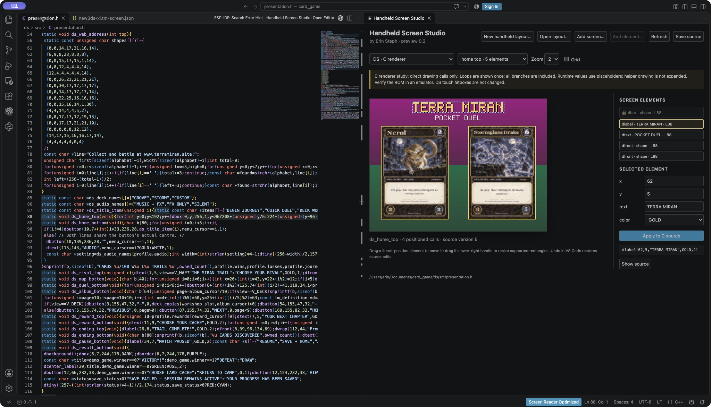

# Handheld Screen Studio

A visual layout editor for Nintendo handheld screens, from
the original Game Boy to New Nintendo 3DS XL.

Create screen layouts, choose a handheld profile, add screens and elements, and
drag or resize them beside their source. Scan C/C++ drawing functions, edit
supported literal calls, and export portable layouts as readable C source.

## Screenshots

Star Post is the original example layout included with the extension.


The static C adapter previews drawing calls from a compatible DS project.
The pictured project and its assets are not included with the extension.



## Quick start

**Starting from nothing:** run **Handheld Screen Studio: New Project** from
VS Code's command palette, or click **New project…** in the editor. Choose a
handheld, project name, **Empty project** or **Starter layout**, and a new folder.
No existing project or screen is required. An empty project contains **zero
screens** and can already build a blank display.

The new folder opens with Screen Studio and its included layout. Click
**New screen…** to create the first screen, add elements, then **Save** and run
**Build handheld project**. Saving updates the generated drawing files and
screen navigation in that same folder, so repeated exports are unnecessary.
Game logic in `source/main.c` and build settings are preserved.

**Editing an existing project:** run **Handheld Screen Studio: Open Editor**.
A layout in the workspace is discovered automatically; otherwise use
**More… → Open layout…** or **Scan C/C++…**. Select a screen, drag elements or edit
properties, then Save. The preview fits the available width by default.
**New screen…** can also start a layout when no source is open.

**More…** contains project adaptation, layouts and separate source/project
export. **New portable layout…** creates screen-design data without SDK files;
it can start with no screens and still be exported. Runnable projects include
their own portable layout alongside generated C.

Files created by version 0.6 and later include `.handheld-project.json` to track
which screen files the editor generated. If one of those files is edited
manually, regeneration stops with an explanation rather than replacing it.
Use `source/main.c` for custom game code. Older exported projects can be
exported once to a new folder to enable linked regeneration; existing folders
are never overwritten.

The `examples` directory contains the original **Star Post** layouts and a
raylib drawing example. All editor changes use VS Code's undo stack; version
checks refuse stale edits.

## Handheld profiles

| Family | Models | Logical layout size |
| --- | --- | --- |
| Game Boy | Original, Pocket, Light | 160 × 144, four-shade preview |
| Game Boy Color | Color | 160 × 144 |
| Game Boy Advance | Original, SP, Micro | 240 × 160 |
| Nintendo DS | Original, Lite | Top and bottom: 256 × 192 each |
| Nintendo DSi | DSi, DSi XL | Top and bottom: 256 × 192 each |
| Nintendo 3DS | 3DS/XL, 2DS, New 3DS/XL, New 2DS XL | Top: 400 × 240; bottom: 320 × 240 |

XL and hardware revisions share their family's logical layout resolution.
The 3DS preview represents one 2D eye view; it does not simulate stereoscopic
depth. The profiles select logical screen sizes. Runnable project export maps them to
the family targets below; hardware revisions do not get separate SDK backends.
General sprite, palette-bank and VRAM budgets are not validated; the GB project
backend separately checks its supported tile limit.

Screen dimensions follow [Pan Docs](https://gbdev.io/pandocs/),
[GBATEK](https://mgba-emu.github.io/gbatek/), and
[Nintendo's 3DS specifications](https://www.nintendo.co.jp/event/conference2010/3ds/spec.pdf).

## Align both displays

On **DS, DS Lite, DSi/XL and every 3DS/2DS/New profile**, enable **Both screens**
next to Zoom. The upper and lower displays are stacked at one shared zoom,
with a small **4-pixel preview gap**. Fit zoom keeps the pair visible where
space permits. The 3DS upper/lower canvases keep their native 400/320 widths
and are centred, so the preview does not stretch either display.

Open **Screen pairing & gap** to choose what appears on each display with the
**Upper / Lower** selectors. Click a display or **Edit upper / Edit lower** to make it active;
that first click only activates it. The element list, properties, dragging and
resizing apply to the active display. The other remains visible for alignment.
Dragging across the gap keeps editing the original active screen.

The gap can be set from 0 to 32 preview pixels. These view settings never change
layout coordinates, display assignments, exported images or generated game code.
Portable layouts offer only screens assigned to the corresponding display.
Scanned source functions can be paired explicitly; native DS top/bottom names
supply defaults. Reusing the same source function on both displays still shares
that function's underlying code.

## Portable layout files

Portable `.tm-screen.json` files contain a device ID and named screens with
display assignments and drawing elements. They are intentionally separate from
any game's runtime code. Use **Export source…** to generate C drawing code. Target SDK integration
is still needed to use the result in an actual game. Changing a profile changes the preview canvas; it does not
rescale elements or automatically optimise them for that hardware.

Game Boy layouts map colours to four shades in the preview. The other profiles
use an illustrative named palette. This is not a hardware-accurate emulator.

## Elements and images

**Add element…** offers text, rectangles, borders, buttons and PNG images in a
portable layout. Import copies the PNG into an adjacent `.assets` folder using
a content-based filename. Keep that folder with the layout when moving or
sharing it. Images support transparency, dragging and resizing. PNGs are limited
to 512 × 512 pixels and 4 MiB each, with at most 32 images and 1,048,576 combined
image pixels per layout. Paths stay local to the layout folder.

The properties panel includes **Duplicate**, **Delete**, **Center X/Y**, and,
for layouts, **Bring forward / Send backward**. Later elements draw on top.
These changes are undoable through VS Code.

In C/C++ source, **Add element…** reuses a positioned drawing call from the
selected screen as a template. Duplicate and delete require a standalone call
on its own line; control flow and complex expressions need source edits.
Source images support raylib `DrawTexture(texture, x, y, tint)` with an
unambiguous `Texture2D`/`Texture` initializer using `LoadTexture("path.png")`
in the same file. PNG paths are resolved relative to the workspace folder;
texture size is previewed and literal positions can be moved. Tint is not
simulated. Reusing a texture call preserves its loading code; importing a new
texture into arbitrary source still needs the project's resource-loading setup.

Images retain their original colors, including on Game Boy profiles; image
palette conversion and console texture budgets are not validated.

## Export source

Open a portable layout and select **More… → Export source…**. All screens in the layout
are written to a new source file; existing files are never overwritten.

- **Standalone C99 renderer:** complete drawing code, named screen functions,
  palette, preview font, screen metadata and an `hss_render()` entry point.
  Supply a `uint32_t` pixel buffer with the screen's exact dimensions. The
  result uses `0xRRGGBB` pixels and compiles without a graphics library. Connect
  the buffer to the target SDK's display or replace the drawing backend.
- **Existing GBA/DS renderer functions:** offered when the workspace contains a
  matching supported renderer and the layout uses that device family. The
  exporter checks for five-argument box, border and text functions and emits
  calls to them. Include the result after those functions and the palette.
  Host fonts and colors may differ; text scales above two are rejected.
  Image layouts use standalone export because this adapter has no texture loader.

Standalone export embeds image pixels and draws scaled RGBA images over the
screen buffer; no external image library is required by the exported C.

Both exports preserve named screens, drawing order, literal positions, text
and supported shapes. Buttons export their visuals; navigation, input hitboxes,
display selection and build setup remain part of the game. Standalone C is a
software renderer, not a console ROM or complete SDK application. Its pixel
buffer uses four bytes per pixel, so small devices may need a tiled or indexed
backend. No stereo or hardware resource budgeting is generated.

## Export a runnable project

Choose **More… → Export runnable project…** while editing a portable layout.
Select a **new folder**; existing folders are never overwritten. This export
includes startup code, display integration, the screen renderer, a main loop,
previous/next-page controls, a Makefile, a VS Code build task and the original
layout with its PNG assets. The ordinary **Export source…** action remains
available when only drawing code is needed.

| Selected profile | Toolchain | Build output |
| --- | --- | --- |
| Game Boy, Pocket, Light | [GBDK 2020](https://gbdk.org/docs/api/docs_getting_started.html) | `handheld.gb` |
| Game Boy Color | GBDK 2020 | `handheld.gbc` |
| GBA, SP, Micro | [devkitPro gba-dev](https://devkitpro.org/wiki/Getting_Started) | `handheld.gba` |
| DS/Lite, DSi/XL | devkitPro nds-dev | `handheld.nds` |
| 3DS/XL, 2DS, New variants | devkitPro 3ds-dev | `handheld.3dsx` |

Install the appropriate SDK and GNU Make, open the exported folder, and run
**Terminal → Run Build Task → Build handheld project**, or `make`. For GBDK,
set `GBDK_HOME`; for devkitPro, set `DEVKITPRO` and `DEVKITARM`. The exported
README contains the commands and controls. Export itself does not install SDKs,
execute a build, download tools or launch an emulator.

**Right/A** advances to the next page; **Left/B** returns to the previous page.
On dual-screen devices, each display cycles through its own screens in layout
order. An unused display stays black. **START** exits the 3DS application to the
Homebrew Launcher. Add gameplay in `source/main.c`; button elements still draw
visuals and require game-specific actions and touch hitboxes.

GB screens are rasterized into banked 2bpp tiles with four shades. GBC screens
use one four-color palette per screen, quantized from the layout. More than
256 unique tiles on a screen prevents export with an explanation. GB/GBC tiles regenerate when the included layout is saved; ARM projects
update the generated C drawing functions in `source/layout.c`. These initial templates
prioritize displaying layouts over animated or hardware-optimized rendering.

GBA uses 153,600 bytes for its software buffer in EWRAM; DS uses 196,608 bytes
and limits embedded RGBA image data to 2 MiB; 3DS uses 384,000 bytes. Large
projects still need SDK link/memory checks. DSi uses the DS-family `.nds` target
and the SDK's default ARM7 service; DSi-specific hardware is not used. 3DS
output is a 2D Homebrew Launcher `.3dsx`, without CIA packaging or stereoscopy.
SDKs, libraries, firmware and emulators are not bundled.

## C/C++ source discovery

**More… → Scan C/C++…** searches up to 200 source/header files, at most 512 KiB per file
and 16 MiB total. Common build, dependency and version-control directories are
excluded. The scan is static: it never runs game code, evaluates expressions or
invokes a compiler. C++ namespaces, simple class methods and duplicate function
names are supported; this is not a complete C++ parser.

| Drawing convention | Recognised calls |
| --- | --- |
| Simple GBA/DS C renderer | `box`, `border`, `text`, `label` and the supported primitives below |
| [raylib](https://github.com/raysan5/raylib/blob/master/src/raylib.h) | `DrawRectangle`, `DrawRectangleLines`, `DrawText`, `DrawLine`, `DrawTexture` |
| [sf2d](https://github.com/xerpi/sf2dlib/blob/master/libsf2d/include/sf2d.h) | `sf2d_draw_rectangle`, `sf2d_draw_line` |
| [Citro2D](https://github.com/devkitPro/citro2d/blob/master/include/c2d/base.h) | `C2D_DrawRectSolid` |
| [DS gl2d](https://github.com/devkitPro/libnds/blob/master/include/gl2d.h) | `glBoxFilled`, `glBox` |

Choose the preview device and display manually for scanned sources. Fonts,
colors and depth are approximate; the scan does not infer the game's render
state. Endpoint-based calls remain read-only. Literal arguments can be edited
where their meaning is known. Dynamic positions and runtime text remain locked.
Loops appear once, all branches are included, complex helper calls are not expanded,
and unknown APIs or complex structures are omitted. In particular, tilemaps,
other sprite APIs, arbitrary SDL rectangles and structured Citro2D text are not imported.
Detected source is edited directly; it is not automatically converted to JSON.

### Adapting project drawing functions

Simple local forwarding helpers are recognised automatically, including chains
of up to four helpers and reordered arguments. For example, a `caption(x, y,
text)` function that only forwards to `DrawText(text, x, y, 14, WHITE)` can be
edited through calls to `caption()`. The helper body stays unchanged. Arithmetic,
branches, side effects, reused arguments and ambiguous definitions prevent
inference. Helpers with a fixed axis can be previewed but remain read-only.

For an unfamiliar drawing API, choose **More… → Adapt drawing function…**.
Select what the function draws and map its zero-based argument positions.
This saves `.handheld-screen-studio.json` in that workspace folder. Project
mappings take precedence over built-in argument maps in that folder. The mapping
is editor configuration, not a format the game must read. It can also be edited
directly and saved:

```json
{
  "format": "handheld-source-adapters",
  "version": 1,
  "functions": {
    "paint_label": { "type": "text", "x": 0, "y": 1, "text": 2, "color": 3 },
    "paint_panel": { "type": "box", "x": 0, "y": 1, "width": 2, "height": 3, "color": 4 }
  }
}
```

Maps support text, filled rectangles and borders. Optional `scale` or `fontSize`
positions describe text sizing. The editor does not infer what an arbitrary
function means: a project mapping explicitly supplies that meaning. Complex
structures, transforms and game state still require source-side work.

### Creating screens in existing source

In a scanned source file, **New screen…** uses the selected drawing function as
a template. It keeps the function signature, scope, local variables and body,
creates a unique name in the same style, and changes the first literal text
label to the new title when available. The original function is untouched;
the insertion is undoable. Review inherited drawing/game logic before connecting
the new function to navigation. Declarations that cannot be copied safely are
rejected, including out-of-class qualified C++ definitions without a matching
new declaration. The editor does not add navigation or input behavior.

## Native GBA/DS renderer adapter

For workspaces with `gba/src/presentation.h` or `ds/src/presentation.h`, the
editor discovers supported drawing functions automatically. It recognises the
`text`, `box`, `border`, `front`, `art`, `label`, `tiny`, `wrap` primitives and
their supported `d`-prefixed counterparts. This is an explicit adapter for that
simple C drawing convention, not a universal C/C++ scene parser.

- Literal integer positions can be dragged. Supported literal sizes, strings
  and named palette values can be edited without replacing surrounding code.
- Loops are collected once and all branches are included. Complex helper drawing is
  not expanded, runtime text uses placeholders, and dynamic coordinates remain
  locked. Native tiny-font preview is approximate.
- The adapter reads the original 5×7 font from `gba/src/font.h` and indexed
  artwork arrays from the selected port's `assets/cards.c`. Artwork is read
  locally and is not bundled with the extension.
- **Adding a C screen creates a function; navigation must be wired separately.**
  Moving DS drawing calls does not move input hitboxes.
- Verify the compiled game in an emulator. Project export creates buildable source separately; this extension does not run
  a compiler or emulator, or publish a game. Broader source scanning supports only the explicit
  call conventions listed above.

## Privacy

The extension runtime contains no telemetry, account sign-in or network
requests. Bundled examples are original Star Post layouts; no existing game
project, ROM or artwork is bundled. README screenshots of an existing project
are documentation only. Source and layout edits are disabled
in untrusted workspaces. Edits affect selected layout/source documents, explicitly created source/project exports and workspace drawing maps. PNG import also copies selected images into the layout
asset folder. Linked projects update only their hash-checked generated screen
files and project metadata on layout save. Referenced PNGs are read locally. Source scanning reads only the
bounded set of workspace files described above.

Nintendo and the console names are trademarks of their respective owners.
This independent tool is not affiliated with or endorsed by Nintendo.
